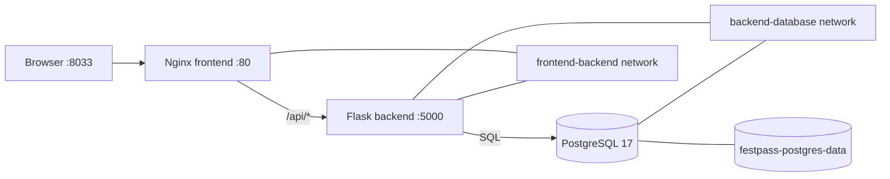

# FestPass — Docker & Container Security Assessment

A three-tier event-registration app built for the Docker & Container Security practical. The project follows the supplied assessment PDF and is organized to reproduce its five stages on Windows 11 with PowerShell and Docker Desktop.

> **Assessment status:** the source, tests, Compose definitions, and safe PowerShell workflows are prepared. Docker builds/runs, Trivy scans, Docker Hub pushes, Cosign operations, and genuine screenshots have **not** been reported as successful unless their actual local output is captured below. Several stages still require tools or authentication on the assessment machine.

## Student and repository details

| Item | Value |
|---|---|
| Name for README | alok docker assesment |
| REGNO | `2400290120033` |
| PORT | `8033` (80 + the last two REGNO digits, 33) |
| Docker Hub username | `alok8756368244` |
| Docker Hub repository | [alok8756368244/fest-backend](https://hub.docker.com/r/alok8756368244/fest-backend) |
| GitHub repository | [-ALOK2458-2400290120033-docker-assessment](https://github.com/ALOK2458/-ALOK2458-2400290120033-docker-assessment) |

The GitHub URL and Docker Hub username above came from the student. The Git remote is configured to the GitHub URL, but no push or public-access verification has been performed.

## Objectives

- Containerize the Flask API first with the required Python 3.9 base.
- Run the web page, API, and PostgreSQL together with an isolated two-network Compose design and persistent storage.
- Scan both backend versions with Trivy and remediate the initial image.
- Publish versioned images to the student's Docker Hub account.
- Sign the immutable `1.0.0` digest with Cosign and demonstrate rejection of the unsigned `1.0.1` digest.
- Keep credentials and signing secrets out of Git and capture genuine assessment evidence.

## Architecture



- **Frontend:** responsive HTML/JavaScript registration form served by Nginx.
- **Nginx:** serves the page and reverse-proxies `/api/` requests to `backend:5000`; the page never connects to PostgreSQL.
- **Backend:** Flask endpoints, parameterized SQL, database error responses, version/REGNO/hostname health details, and a non-root production image for the remediated release.
- **Database:** PostgreSQL 17 Alpine; its data directory is stored in the named volume `festpass-postgres-data`.
- **Network boundary:** frontend and backend share `frontend-backend`; backend and database share the internal `backend-database` network. Frontend is not a member of the database network.

`compose.yaml` is the final registry-image configuration for Stage 4. `compose.stage2.yaml` is a small local-build override so the Stage 2 stack can still be reproduced before publishing; it adds a backend build from `backend/` and tags that development image `fest-backend:0.2`.

## Prerequisites

- Windows 11, PowerShell, Git, and Docker Desktop running with Linux containers enabled.
- An existing GitHub repository at the URL above; verify it is public before final submission.
- A Docker Hub account matching `alok8756368244`. Use a Docker Hub access token for login.
- Trivy installed from its official documentation and its vulnerability database downloaded. Do **not** install versions `0.69.4`, `0.69.5`, or `0.69.6`.
- Cosign installed from its official release/documentation.
- No WSL requirement: Docker Desktop and the commands below use the Windows PowerShell Docker CLI.

Check Docker Desktop before running a stage:

```powershell
docker version
docker compose version
```

The Docker version output must include a **Server** section. Start Docker Desktop and wait for it to be ready if it does not.

## Windows setup and local configuration

From the project directory, create an ignored `.env` with a randomly generated local database password and load its values into the current PowerShell process:

```powershell
Set-ExecutionPolicy -Scope Process -ExecutionPolicy Bypass -Force
. .\scripts\setup.ps1
```

The execution-policy change applies only to this PowerShell process. The setup script only creates `.env` if it does not already exist. It does not print the generated password or edit your PowerShell profile. Review `.env.example` for the non-secret settings; do not copy the password into source files, screenshots, or Git. `.env.example` is safe to commit; `.env` is not.

Before each assessment terminal screenshot, set the prompt in that PowerShell window using the required format:

```powershell
$REGNO = "2400290120033"
function prompt { "[$REGNO] PS $(Get-Location)> " }
```

This is session-only and does not change your normal shell configuration.

## Stage 1 — backend container

The assessment's initial base image is deliberately retained in `backend/Dockerfile.stage1` as `python:3.9`. The final `backend/Dockerfile` is the Stage 3 remediated image. Both copy `requirements.txt` before `app.py`. The stage script uses the preserved initial Dockerfile so you can reproduce the first build after later stages.

Run:

```powershell
.\scripts\stage1.ps1
```

The script builds `fest-backend:0.1`, shows the image size, runs a container named `backend` on `8033:5000`, prints the health response, `docker ps`, and logs. With PostgreSQL absent, the health response should include `"database": false` and REGNO `2400290120033`.

After capturing S1 evidence, remove only that standalone assessment container:

```powershell
docker rm -f backend
```

Do not remove the image unless you have checked whether a later assessment step still needs it.

## Stage 2 — Compose stack and network isolation

`compose.yaml` defines exactly three services (`db`, `backend`, `frontend`), explicit networks, the database health check, and the named persistence volume. The frontend is not attached to `backend-database`. `compose.stage2.yaml` overrides the backend image with a local build for the pre-publication exercise.

Start and inspect the local stack:

```powershell
.\scripts\stage2.ps1
docker compose -f compose.yaml -f compose.stage2.yaml ps
Invoke-RestMethod http://localhost:8033/api/health | ConvertTo-Json
```

The Stage 2 script waits for PostgreSQL to become healthy, checks backend health, verifies the frontend is not attached to the database network, and uses a temporary `busybox` diagnostic container attached **only** to the frontend/backend network to query `db`. It expects a real DNS lookup failure. It does not infer isolation from the absence of `ping` in Nginx.

Open [http://localhost:8033](http://localhost:8033) in a browser. Add two registrations through the page, or use these PowerShell examples:

```powershell
Invoke-RestMethod -Method Post -Uri http://localhost:8033/api/registrations `
  -ContentType "application/json" -Body '{"name":"Demo Student One","event":"Hackathon"}'
Invoke-RestMethod -Method Post -Uri http://localhost:8033/api/registrations `
  -ContentType "application/json" -Body '{"name":"Demo Student Two","event":"Tech Quiz"}'
Invoke-RestMethod http://localhost:8033/api/registrations | ConvertTo-Json -Depth 5
```

To demonstrate persistence, capture the existing registrations, then recreate the containers **without** deleting volumes:

```powershell
docker compose -f compose.yaml -f compose.stage2.yaml down
docker compose -f compose.yaml -f compose.stage2.yaml up -d
Invoke-RestMethod http://localhost:8033/api/registrations | ConvertTo-Json -Depth 5
docker volume ls
```

Do not use `docker compose down --volumes` / `-v`; that deletes the database data.

## API reference

All browser requests use the same-origin Nginx paths:

| Method and path | Behavior |
|---|---|
| `GET /api/health` | HTTP 200 with service, REGNO, version, container hostname, and a boolean `database` status. The API remains available when the database is down and reports `false`. |
| `GET /api/registrations` | HTTP 200 with registrations ordered by ID; database errors return HTTP 503. |
| `POST /api/registrations` | JSON body `{"name":"Example Student","event":"Hackathon"}`; trims and validates non-empty string values, uses parameterized SQL, returns HTTP 201; invalid/missing values return HTTP 400. Database errors return HTTP 503. |

The backend reads `REGNO`, `APP_VERSION`, `DB_HOST`, `DB_NAME`, `DB_USER`, and `DB_PASSWORD` from the process environment. The backend listens on container port 5000. Registration table creation is automatic on first successful database operation.

## Automated tests

The API tests mock database access; they do not connect to or alter an assessment database. With Python and the application requirements installed in an isolated virtual environment:

```powershell
py -m venv .venv
.\.venv\Scripts\Activate.ps1
python -m pip install -r backend\requirements.txt
python -m unittest discover -s tests -v
```

The tests cover health connectivity states, registration success and listing, missing/blank data, status codes, and database failure behavior.

## Stage 3 — Trivy scan and remediation

The initial image remains based on the required `python:3.9`; the remediated image uses the version-tagged `python:3.13.9-slim-bookworm` base, exact pinned Python dependencies, and a non-root UID. The image starts with Gunicorn and exposes only the application port.

Install Trivy from its official installation page. Before scanning, update/download its database:

```powershell
trivy image --download-db-only
```

Then run:

```powershell
.\scripts\stage3.ps1
```

It builds the initial image, records actual table output in `reports/trivy-before.txt`, builds `fest-backend:0.2`, records the after-scan output, then runs the required CRITICAL/ignore-unfixed check and captures `$LASTEXITCODE` immediately. A nonzero result stops the script; inspect real findings and apply safe compatible fixes before rebuilding and rescanning.

| Image tag | Base image | CRITICAL count | HIGH count | Image size | Scan status |
|---|---|---:|---:|---:|---|
| `fest-backend:0.1` | `python:3.9` | Not scanned | Not scanned | Not measured | Pending: Trivy and Docker runtime unavailable here |
| `fest-backend:0.2` | `python:3.13.9-slim-bookworm` | Not scanned | Not scanned | Not measured | Pending: Trivy and Docker runtime unavailable here |

The two report files currently contain only an explicit “NOT RUN” note, not fabricated scanner output. Replace them only by running the script with Trivy and Docker available. Update the table with the actual report totals and actual image sizes. The required pass condition is exit code `0` for:

```powershell
trivy image --severity CRITICAL --ignore-unfixed --exit-code 1 fest-backend:0.2
$criticalExitCode = $LASTEXITCODE
Write-Output "Critical-with-fix scan exit code: $criticalExitCode"
```

## Stage 4 — Docker Hub release

`scripts/stage4.ps1` authenticates interactively, builds the fixed backend with `APP_VERSION=1.0.0`, pushes both tags, pulls the registry image through the final `compose.yaml`, checks health and prints registrations. Use a Docker Hub access token at the interactive password prompt; never put it in a command, script, `.env`, screenshot, or Git.

```powershell
.\scripts\stage4.ps1
```

Expected tags (not yet pushed):

- `alok8756368244/fest-backend:1.0.0`
- `alok8756368244/fest-backend:1.0`

**Published digest:** not available yet; the push has not been run. Copy the real `sha256:...` digest printed by the successful `1.0.0` push into this section and use that exact digest for Stage 5. Do not infer it from a local tag.

After publishing, the Docker Hub Tags page should be [hub.docker.com/r/alok8756368244/fest-backend/tags](https://hub.docker.com/r/alok8756368244/fest-backend/tags). Confirm that the repository is public. Do not delete local images until the registry pull and application checks have succeeded and the Stage 3 evidence is safely captured.

## Stage 5 — Cosign signing and verification

Install Cosign from its official release. First check `git status` and confirm `.env`, `cosign.key`, access tokens, and other private credentials are not staged. `*.key` is ignored. The key-generation command is interactive and prompts for a password; keep `cosign.key` private and commit **only** the generated `cosign.pub`.

After Stage 4 has produced the real immutable digests for both `1.0.0` and the unsigned `1.0.1`, run the prepared workflow (substitute the actual digest values):

```powershell
.\scripts\stage5.ps1 -Digest1000 "sha256:<actual-1.0.0-digest>" -Digest1001 "sha256:<actual-1.0.1-digest>"
```

The script generates the key pair if it does not exist, signs `IMAGE_NAME@digest` for `1.0.0`, verifies with `cosign.pub`, then verifies the `1.0.1` digest without signing it. It only treats the negative test as proven when verification fails with a missing-signature message, not for authentication, network, command, or reference errors.

- Positive result: `1.0.0` has an acceptable signature made by this student's key and verifies with this repository's public key.
- Negative result: `1.0.1` is deliberately unsigned, so verification with the same public key should reject it for lack of a matching signature.
- Actual results: not run; Cosign and registry access are not available in the current environment. No digest or key has been invented.

## Security measures

- PostgreSQL password is generated locally by `setup.ps1`; `.env` is ignored and not copied into the backend image.
- No Docker Hub credential or signing password is stored in source code or scripts.
- SQL uses parameters for user-supplied values.
- Backend runs as UID/GID 10001 in the remediated image, with Python bytecode/cache disabled and only port 5000 exposed.
- Compose uses separate frontend/backend and backend/database networks; the database network is internal.
- PostgreSQL data uses a named volume; ordinary `compose down` retains it.
- The frontend uses text nodes (`textContent`) rather than injecting registration data with `innerHTML`.
- The Cosign workflow signs by digest, checks staged-file safety, and requires a real negative missing-signature result.

## Screenshot checklist

Capture genuine, unedited screenshots on your assessment machine. Save the **whole window** in `screenshots\`; do not crop out the REGNO prompt. Every terminal screenshot must show the exact REGNO prompt set above. Browser screenshots must show the address bar; the Docker Hub screenshot must also show the real username. Do not create or submit screenshots until the corresponding command/page actually ran.

| Evidence filename | What it must demonstrate | Command/page and expected visible evidence |
|---|---|---|
| `S1-2.png` | Stage 1 image build and size | Run `.\scripts\stage1.ps1`; show successful `fest-backend:0.1` build/listing and its image size. |
| `S1-3.png` | Stage 1 container, health, and logs | Show `docker ps`, `Invoke-RestMethod http://localhost:8033/api/health` with REGNO and `database: false`, and `docker logs backend`. If needed, use two genuine screenshots with the same filename suffix convention documented by your assessor. |
| `S2-2.png` | Frontend cannot resolve database | Run `.\scripts\stage2.ps1`; show the diagnostic `busybox nslookup db` failure while it is attached only to the frontend/backend network, plus the script's network membership check. |
| `S2-3.png` | Working frontend with two registrations | Browser at `http://localhost:8033/`, address bar visible, REGNO/service status and both saved registrations visible. |
| `S2-4.png` | Persistence and named volume | After `compose down` then `up -d` without `-v`, show both registrations in the page/API and `docker volume ls` showing `festpass-postgres-data`. Use a whole-window layout that clearly shows both; if your assessor permits multiple files, capture each view separately. |
| `S3-1.png` | Before scan and severity totals | Run the actual Trivy scan for `fest-backend:0.1`; show the totals and matching `reports/trivy-before.txt`. |
| `S3-3.png` | After scan and threshold exit code | Show the actual `fest-backend:0.2` scan and CRITICAL/ignore-unfixed command with `$criticalExitCode` equal to `0`; include actual after report evidence. |
| `S4-1.png` | Registry push and digest | Show successful push output for `alok8756368244/fest-backend:1.0.0` and its actual digest. Never show tokens. |
| `S4-2.png` | Public Docker Hub tags | Browser on the repository Tags page, address bar and `alok8756368244` visible, with `1.0.0` and `1.0` tags. |
| `S4-3.png` | Run from registry | Browser at `http://localhost:8033/` showing backend version `1.0.0`, REGNO, database status, and the saved registrations. |
| `S5-1.png` | Key generation and public-key evidence | Show successful `cosign generate-key-pair` and the public `cosign.pub` filename or contents only. Never show the password or private key. |
| `S5-2.png` | Sign immutable release digest | Show the successful Cosign signing command/result using the actual `1.0.0` digest. Keep password input hidden. |
| `S5-3.png` | Positive verification | Show successful `cosign verify --key cosign.pub` for the exact signed digest. |
| `S5-4.png` | Genuine unsigned rejection | Show `cosign verify` against the real unsigned `1.0.1` digest and the missing-signature rejection message; not an auth/network/command failure. |

The `screenshots` directory is prepared, but it contains no fabricated evidence. The `.gitkeep` file only preserves the empty folder.

## Git stage-by-stage workflow

The configured remote is the student's supplied GitHub URL. No push has been made. Review `git status` and the staged file list before each commit; make the final push only after checking the public repository, README, reports, genuine screenshots, and absence of secrets.

Suggested assessment commit sequence:

```powershell
git add backend\app.py backend\requirements.txt backend\Dockerfile backend\Dockerfile.stage1 backend\.dockerignore scripts\stage1.ps1
git commit -m "Stage 1 done: backend containerization"

git add compose.yaml compose.stage2.yaml .env.example .gitignore frontend\index.html frontend\nginx.conf scripts\setup.ps1 scripts\stage2.ps1 tests\test_api.py screenshots\.gitkeep
git commit -m "Stage 2 done: compose stack and network isolation"

git add backend\Dockerfile backend\requirements.txt scripts\stage3.ps1 reports README.md
git commit -m "Stage 3 done: security scanning and remediation"

git add compose.yaml scripts\stage4.ps1 README.md
git commit -m "Stage 4 done: versioned Docker Hub release"

git add scripts\stage5.ps1 .gitignore README.md cosign.pub
git commit -m "Stage 5 done: cosign signing and verification"

git add README.md
git commit -m "Final submission: documentation and evidence"
```

Only run the commit for a stage after completing that stage; remove a `cosign.pub` path from the command until the real public key has been generated. Before the final push:

```powershell
git status --short
git diff --cached --name-only
git ls-files .env cosign.key
git remote -v
```

Confirm `.env` and `cosign.key` are absent from tracked/staged files, review the actual README values, scan reports, key, and genuine screenshots, then push once:

```powershell
git push -u origin main
```

If Git reports that the branch has a different name, inspect `git branch --show-current` and push that branch. Do not force-push or rewrite history.

## Validation script

```powershell
.\scripts\validate.ps1
.\scripts\validate.ps1 -RequireRunningStack
```

The script checks required files, `.env` Git-ignore status, private-key tracking, Compose syntax, obvious credential patterns, tool availability, optional backend health, and missing evidence filenames. Missing Trivy/Cosign, image tags, public key, scans, or evidence are reported as incomplete; the script does not manufacture them. Start Docker Desktop before expecting daemon-backed checks to pass.

## Troubleshooting

- **Docker CLI cannot reach the server:** start Docker Desktop, wait for the engine, check `docker version`, and ensure Linux containers are enabled.
- **Port 8033 is occupied:** identify the process using that port and stop only the intended process; do not change the assessment port without approval.
- **Compose says a variable is missing:** from the project directory run `. .\scripts\setup.ps1`; verify `.env` exists and compare non-secret values with `.env.example`.
- **PostgreSQL is unhealthy:** inspect `docker compose -f compose.yaml -f compose.stage2.yaml logs db`; verify the database service has the same `DB_NAME`, `DB_USER`, and `DB_PASSWORD` as the backend.
- **Backend health has `database: false`:** check `docker compose -f compose.yaml -f compose.stage2.yaml logs backend db`; wait for the `pg_isready` health check and confirm `DB_HOST=db`.
- **Nginx returns 502:** inspect `docker compose -f compose.yaml -f compose.stage2.yaml logs frontend backend`; ensure Nginx has `/api/` proxy configuration and the backend is listening on 5000.
- **Frontend image lacks ping:** do not treat a missing executable as an isolation result. The Stage 2 script uses a temporary BusyBox container with only the frontend/backend network and checks that DNS resolution for `db` actually fails.
- **Data disappears:** verify `docker volume ls` includes `festpass-postgres-data`; do not run `docker compose down -v`.
- **Trivy is absent or reports a database/download error:** install it from the official Trivy documentation, run `trivy image --download-db-only`, then rerun the scan. The banned 0.69.4, 0.69.5, and 0.69.6 releases must not be used.
- **Docker Hub push is denied:** confirm interactive login used the correct username and a valid access token, and that the repository is public/writable. Never paste the token into a command or README.
- **Cosign verification fails unexpectedly:** verify the digest format, registry availability, and key password flow. The negative test counts only when the output specifically reports no matching signature.
- **PowerShell blocks virtual-environment activation:** use `.\.venv\Scripts\python.exe -m pip ...` and `.\.venv\Scripts\python.exe -m unittest discover -s tests -v`, or adjust the execution policy only for the current process if permitted.

## AI tools

GitHub Copilot (AI assistant in VS Code) was used to interpret the supplied assessment, prepare the Flask application, Docker/Compose configuration, PowerShell workflows, tests, and documentation. All machine-specific builds, scans, registry operations, signatures, and screenshots must be executed and evidenced on the student's own machine.

## Incomplete tasks — current environment

- Docker Desktop CLI is installed, but a working Docker daemon/image build has not been confirmed.
- Trivy and Cosign are not installed; no image scan, vulnerability count, image size, signature, or verification result is claimed.
- Docker Hub authentication/push is not complete; tags and the `1.0.0` digest are not yet published or known.
- No Cosign key pair has been generated; `cosign.pub` must be created by the student and committed, while `cosign.key` must remain private and ignored.
- The API test suite has not yet been executed in this environment.
- No assessment screenshots have been captured; all evidence items in the checklist remain to be collected after running the real commands/pages.
- No final GitHub push/public-repository check has been performed.

## Final submission checklist

- [ ] Run the local test suite and `scripts/validate.ps1`; fix any actual failures.
- [ ] Complete Stage 1 and Stage 2 on Docker Desktop; capture genuine S1/S2 evidence.
- [ ] Run real before/after Trivy scans, inspect findings, record totals/sizes/exit code, and capture S3 evidence.
- [ ] Authenticate to Docker Hub, publish both `1.0.0`/`1.0` tags, record the real digest, and capture S4 evidence.
- [ ] Generate a new password-protected key pair; keep `cosign.key` private, commit only `cosign.pub`, sign/verify the digest, and prove unsigned rejection for `1.0.1`.
- [ ] Save each genuine screenshot under its exact evidence filename in `screenshots\`.
- [ ] Check `git status`, tracked/staged secrets, reports, README, and that the GitHub repository is public.
- [ ] Commit completed stages and push the final branch once; submit the confirmed repository URL.
